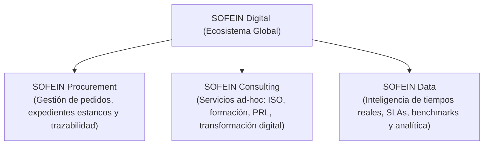
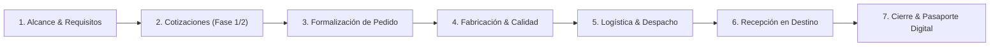
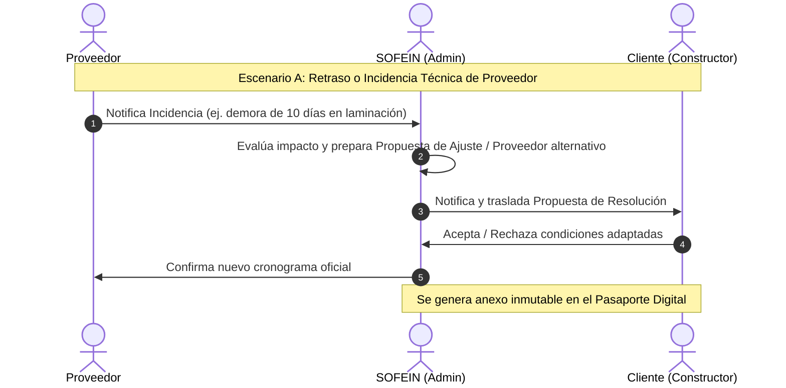

# SOFEIN Procurement — Especificación de Diseño Funcional y Arquitectura UI/UX

> **Documento base:** Síntesis de los documentos de Ángel Plaza (*Apuntes 03 - Guión* y *Apuntes 05 - Descripción detallada*) y notas de alineación estratégica de la reunión del 06/10/2026.

---

## 1. Visión y Ecosistema SOFEIN Digital

**SOFEIN Digital** se consolida como el ecosistema integral de operaciones, servicios y datos para el sector ferroviario, estructurado en tres líneas sinérgicas:

1. **SOFEIN Procurement:** Plataforma central de gestión de expedientes de suministro de materiales de superestructura e infraestructura de vía. Delimita la responsabilidad de SOFEIN, agiliza la relación constructor-proveedor y audita documentalmente todo el ciclo de vida.
2. **SOFEIN Consulting (a futuro):** Gestión de proyectos especializados (implantaciones ISO 9001/14001/53001, auditorías técnicas, proyectos específicos de cliente como fábrica Volkswagen).
3. **SOFEIN Data (a futuro, con recogida activa desde el día 1):** Captura sistemática de marcas de tiempo reales (*lead times* de fabricación, tiempos de validación documental, demoras de transporte, incidencias) para convertir la experiencia operativa en la mayor base de conocimiento y benchmarking del sector ferroviario.

---

## 2. Los 4 Actores (*Players*) y Modelo de Permisos

A diferencia de la versión anterior (3 perfiles), el sistema incorpora al **Destinatario Final** como nuevo rol espectador:

| Rol | Definición en Negocio | Privilegios y Vista en Plataforma |
| :--- | :--- | :--- |
| **1. Admin (SOFEIN)** | Gestor del proceso y mediador | **Acceso total.** Creación y supervisión de expedientes, preselección de proveedores mostrados, mediación de incidencias, validación y rechazo documental, emisión de Pasaporte Digital y administración de usuarios. |
| **2. Proveedores** | Suministradores, talleres, tratadores y transportistas | **Vista acotada a sus encargos.** Recepción de RFQ/cotizaciones, envío de ofertas técnicas y económicas, actualización de hitos fabriles, carga mediante *drag & drop* de certificados de lote, albaranes y gestión de incidencias de producción. *No ven datos comerciales de otros proveedores ni datos sensibles de cliente.* |
| **3. Clientes** | Constructores de vía (contratistas principales) | **Gestión de su pedido.** Definición de necesidades y planos, selección de proveedores en Fase 1 (previa) y Fase 2 (oferta vinculante), seguimiento de trazabilidad por fases, aprobación de cambios/incidencias, consulta de documentos validados y descarga del Pasaporte Digital. |
| **4. Destinatario Final** *(Nuevo)* | Propietario o gestor de la infraestructura (pública: Adif, Metro; privada: Fábrica Volkswagen, etc.) | **Modo Espectador restringido (*Auditor View*).** Solo lectura de alto nivel: estado global de entrega de los materiales de su trazado, cumplimiento de normativa (CE, EN 13230) y Pasaporte Digital consolidado. Sin visibilidad de precios de compra, márgenes ni comunicaciones internas entre constructor y proveedor. |

---

## 3. El "Constructor de Expedientes" (Inspiración Modular Tipo LMS / Moodle)

La gran fuerza diferencial de SOFEIN Procurement radica en el **Constructor de Expedientes Estancos**. Tomamos los principios estructurales de plataformas modulares tipo Moodle (bloques aislados, requisitos previos, cajas de entrega, estados y roles), pero ejecutados con un diseño visual B2B de altísimo nivel (estilo Stripe / Linear / Ramp):

### A. Anatomía de un "Expediente Estanco"
Cada expediente es un entorno hermético e independiente con un ciclo de vida compuesto por 7 fases estándar configurables:

### B. Módulos y Ranuras Documentales (*Deliverable Slots*)
En lugar de una simple carpeta compartida, cada fase del expediente cuenta con **ranuras de entrega estructuradas** con validación y dependencias:
- **Metadatos por ranura:** Documento exigido (ej. *Certificado EN 13230*, *Albarán de salida*, *Ficha técnica*), responsable de carga (Proveedor / Cliente / SOFEIN), fecha límite sugerida, y estado documental.
- **Interacción Drag & Drop:** Carga directa con arrastre de archivos (.pdf, .dwg, .xlsx), previsualización inmediata y verificación de tamaño/formato.
- **Ciclo de Aprobación SOFEIN:**
  - 🟡 *Pendiente de entrega*
  - 🔵 *Entregado / En revisión por SOFEIN*
  - 🟢 *Validado y conforme*
  - 🔴 *Rechazado con observaciones* (alerta automática por email e inbox al responsable indicando qué corregir).

---

## 4. Gestión de Incidencias y Modificaciones de Pedido

En obras ferroviarias las incidencias y variaciones sobre el pedido original son constantes. La plataforma debe ser un cortafuegos jurídico y operativo para SOFEIN, registrando cada cambio con trazabilidad inmutable:

### Tipología de Alteraciones Soportadas:
1. **Incidencias de Suministrador:** Retraso en fabricación, no conformidad en control de calidad de lote, fallo de transporte o incapacidad sobrevenida de servicio. Flujo de respuesta: aceptación de plazo por cliente o reasignación a proveedor suplente.
2. **Modificaciones de Cliente:** Variación de metraje/unidades, cambio en fecha límite de obra, exigencia sobrevenida de ensayos adicionales Adif/ESG. Flujo de respuesta: recalculo de cotización con el proveedor y re-firma del anexo de pedido.
3. **Póliza de Responsabilidad Delimitada:** El contrato/hoja de pedido generado en la plataforma especifica expresamente que la calidad del material y certificaciones corresponden al proveedor, actuando SOFEIN como garante de proceso y seguimiento.

---

## 5. Captura de Datos Operativos (Semilla de "SOFEIN Data")

Para alimentar la futura división **SOFEIN Data**, la plataforma Procurement registrará desde su versión inicial marcas de tiempo y métricas operativas clave en segundo plano:

1. **Lead Time Real vs. Prometido:** Desviación entre la fecha prevista de oferta y la fecha real de entrega en obra.
2. **Tiempo de Ciclo Documental:** Horas transcurridas desde que se solicita un certificado hasta que el proveedor lo sube y SOFEIN lo valida.
3. **Índice de Incidencias por Material:** Tasa de incidencias de traviesas de madera vs. hormigón vs. polímero, fijaciones y carril.
4. **Fiabilidad de Proveedor (*Supplier Reliability Score*):** Puntuación dinámica basada en cumplimiento histórico de plazos y rechazos documentales.

---

## 6. Pasaporte Digital SOFEIN

Entregable final automatizado al cierre del expediente que consolida:
1. Resumen de especificaciones del suministro (materiales, normativas, planos de referencia).
2. Trazabilidad cronológica certificada (fechas de hitos desde RFQ hasta entrega en vía).
3. Histórico auditado de incidencias y resoluciones.
4. Dossier de certificados vinculados (CE, ensayos mecánicos, trazabilidad de madera/acero, huella ambiental si aplica).
5. Sello digital SOFEIN de conformidad de proceso.

---

## 7. Catálogo de Productos Ferroviarios Iniciales (Alcance MVP)

Definido específicamente en los apuntes de Ángel Plaza:
- **Traviesas (Superestructura):**
  - Madera (3 subtipos de madera)
  - Hormigón
  - Polimerizadas
- **Placas de asiento / superestructura**
- **Tirafondos**
- **Clips y fijaciones elásticas**
- **Balasto** *(configurable)*
- **Módulo libre ("Otros / Personalizado"):** Para productos singulares (ej. piezas solicitadas por Siemens o revestimientos para vagones Renfe) sin romper el esquema del expediente estanco.

---

## 8. Plan Maestro de Desarrollo por Fases (7 Pantallas Oficiales — Apuntes 05 y 06)

Para avanzar de menos a más sobre lo esencial aprobado en reunión:

| Fase / Pantalla | Nombre Funcional | Alcance Esencial (Apuntes 05 & 06) | Estado |
| :--- | :--- | :--- | :--- |
| **Base** | **Menús Generales, Visión Global, Directorio y Avisos** | Menús limpios por perfil, switcher sutil en topbar, gráficos interactivos sin saltos, buscador en directo de expedientes, directorio tabla/mosaico con alta, y bandeja de Avisos agrupable con descartados. | ✅ Completado |
| **Pantalla 1** | **Creación de Expediente (Constructor)** | Alta de expediente por Admin (validación directa a Fase 1) y por Cliente (solicitud sujeta a validación SOFEIN), multi-lote de suministros y carga drag & drop de pliegos. | ✅ Completado |
| **Pantalla 2** | **Selector y Matching de Proveedores (Cotizaciones)** | Preselección SOFEIN (mín. 3 proveedores por normativa), selección del Cliente, petición/recepción de ofertas vinculantes y matriz comparativa con checks de requisitos exigibles. | ✅ Completado |
| **Pantalla 3** | **Formalización del Acuerdo y Gestión del Expediente** | **1) Formalización (Fase 3):** Hoja de Pedido / Contrato con proveedor adjudicado, importe, plazo, requisitos marcados, verificación de Acuerdo Marco, cláusula de delimitación de responsabilidad SOFEIN y firmas digitales de Cliente/Proveedor + validación SOFEIN. **2) Gestión Operativa (Fases 4–6):** Panel de control de ejecución donde SOFEIN actualiza el estado de cada fase (Fabricación, Logística, Recepción en obra), plazos reales vs. pactados y avance de cadena de suministro. | 🚧 En curso |
| **Pantalla 4** | **Gestión de la Documentación** | Creación y requerimiento dinámico de nuevas ranuras documentales por parte de SOFEIN en cada fase, subida de archivos por Proveedor/Cliente y flujo de validación/rechazo con motivo. | ⏳ Siguiente |
| **Pantalla 5** | **Registro de Incidencias y Cambios (Mediación MVP)** | Registro de incidencia o modificación de alcance por SOFEIN, redacción de Propuesta de Acuerdo con fecha límite (silencio positivo tras 5 días hábiles) y firmas digitales bilaterales. | ⏳ Pendiente |
| **Pantalla 6** | **Comunicaciones y Avisos del Expediente** | Canal de avisos manuales e hitos automáticos vinculados al expediente para notificar requerimientos o alertas a Cliente y Proveedor. | ⏳ Pendiente |
| **Pantalla 7** | **Pasaporte Digital SOFEIN** | Generación y vista previa del dossier final certificado al concluir la recepción en vía (trazabilidad completa, certificados EN/CE, histórico de adendas y sello SOFEIN). | ⏳ Pendiente |

