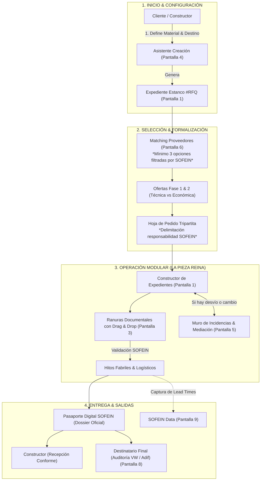

# SOFEIN Procurement — Guión Visual y Lógica de Pantallas para Pizarra

> **Objetivo:** Documento de trabajo para la reunión del **martes a las 12:00 con Ángel Plaza y Flor**.  
> Diseñado para estructurar, dibujar y consensuar en pizarra la lógica de todas las pantallas, su jerarquía de desarrollo y la interacción entre los 4 actores.

---

## 🗺️ 1. El Mapa Macro en Pizarra: El Viaje del Expediente

Antes de dibujar pantallas individuales, este es el diagrama de flujo general que resume todo el modelo de negocio:



---

## 🎯 2. La Foto Real del Desarrollo: Maqueta Visual (🟢) vs Motor a Construir (🟡)

Es clave ser transparentes en la reunión: **lo que está hoy construido es el esqueleto visual navegable** (la maqueta interactiva que enseña cómo se siente la interfaz), mientras que **el motor real del Constructor de Expedientes y su lógica de negocio es la nueva construcción central (amarillo)**:

| Estado | Pantalla / Módulo | Alcance Actual vs Por Desarrollar | Prioridad en la Reunión |
| :--- | :--- | :--- | :--- |
| 🟢 **Maqueta Construida** | **SCR-01: Bandeja Maestra** | Tabla y KPIs visuales operativos en el subdominio. | Para mostrar la visión general de la plataforma. |
| 🟢 **Maqueta Construida** | **SCR-04A: Visor de Expediente Activo** | Esqueleto visual de un pedido en curso (`RFQ-2026-014`) con stepper y simulación de ranuras. | Para enseñar cómo verá el cliente un expediente terminado. |
| 🟢 **Maqueta Construida** | **SCR-06: Destinatario Final** | Maqueta del modo espectador/auditoría sin precios comerciales (Adif / VW). | Para presentar la nueva figura de observador. |
| 🟢 **Maqueta Construida** | **SCR-07: SOFEIN Data** | Cuadro de mando visual con métricas y comparativa de talleres. | Para validar el valor de los datos para consultoría. |
| 🟡 **Nueva Construcción** | **SCR-04B: MOTOR CONSTRUCTOR DE EXPEDIENTES** | **EL RETO CENTRAL:** El motor que crea expedientes desde cero, configura qué fases aplican por material, genera las ranuras documentales y gestiona las dependencias. | **El 80% de la reunión del martes:** Definir esta lógica. |
| 🟡 **Nueva Construcción** | **SCR-02: Motor de Creación de Pedido** | Lógica técnica para dar de alta un pedido validando pliegos y especificaciones de vía. | Sprint Inmediato. |
| 🟡 **Nueva Construcción** | **SCR-03: Matching de Proveedores** | Algoritmo de scoring, regla legal de los 3 proveedores y comparativa de ofertas Fase 1 vs 2. | Sprint Inmediato. |
| 🟡 **Nueva Construcción** | **SCR-05: Motor de Incidencias & Mediación** | Cálculo real de desviación de plazos, mediación de SOFEIN y firmas digitales vinculantes. | Sprint Inmediato. |
| 🟡 **Nueva Construcción** | **SCR-08: Compilador Pasaporte Digital** | Generador de PDF oficial con sellos y archivo ZIP con ensayos de laboratorio. | Sprint Inmediato. |
| 🔵 **Roadmap Futuro** | **EXT-01: SOFEIN Consulting** | Módulo de proyectos ad-hoc (ISO, PRL, transformación digital). | Fase 2. |
| 🔵 **Roadmap Futuro** | **EXT-02: Ecommerce de Vía** | Catálogo transaccional de componentes y repuestos. | Fase 3. |

---

## 📐 3. Esquemas Visuales Wireframe para Dibujar en Pizarra

A continuación se detalla cómo dibujar cada una de las pantallas principales, sus bloques y sus interacciones:

---

### PANTALLA 1: El Constructor de Expedientes (La Pantalla Reina)
> **Quién la usa:** SOFEIN Admin, Constructor (Cliente) y Proveedor (con permisos según su rol).  
> **Inspiración:** Estructura modular estanca tipo Moodle (bloques + entregables + dependencias) con diseño B2B estilo Ramp/Holded/Stripe.

#### Esquema en Pizarra:
```text
+---------------------------------------------------------------------------------------------------------+
| [LOGO SOFEIN]   SOFEIN Procurement  >  Expedientes  >  RFQ-2026-014            [Modo Claro]  [Usuario]   |
+---------------------------------------------------------------------------------------------------------+
| [← Volver a Bandeja]                                                                                    |
|                                                                                                         |
| +-----------------------------------------------------------------------------------------------------+ |
| | BLOQUE 1: CABECERA DE IDENTIDAD & METADATOS ESTANCOS                                                | |
| |  ID: RFQ-2026-014  ·  MATERIAL: Traviesas hormigón PR-22 (Superestructura)                           | |
| |  Destino Vía: Factoría Volkswagen Navarra (Conexión Adif)  ·  Unidades: 14.500 uds                    | |
| |  Cliente: Infraestructuras del Norte  |  Proveedor: IberRail Components  |  Presupuesto: 482.000 €   | |
| |                                                                                                     | |
| |  [ Plazo Pactado: 42 días ]    [ Estimado Real: 48 días (+6d) ⚠️ ]    [ Incidencias: 1 Activa 🔴 ]  | |
| +-----------------------------------------------------------------------------------------------------+ |
|                                                                                                         |
| +-----------------------------------------------------------------------------------------------------+ |
| | BLOQUE 2: STEPPER DE TRAZABILIDAD (7 FASES SECUENCIALES)                                            | |
| |  (1. Alcance ✓) -> (2. Cotización ✓) -> (3. Pedido ✓) -> [4. Fabricación 🔵] -> (5. Logística) ...  | |
| |   (Cada fase es clickable y abre sus correspondientes ranuras de entregables abajo)                 | |
| +-----------------------------------------------------------------------------------------------------+ |
|                                                                                                         |
| [ Pestaña A: Ranuras Documentales (4) ]  [ Pestaña B: Incidencias & Mediación (1) ]  [ Pestaña C: Pasaporte ]
|                                                                                                         |
| +-----------------------------------------------------------------------------------------------------+ |
| | BLOQUE 3: LISTA DE RANURAS DOCUMENTALES DE LA FASE ACTIVA (Deliverable Slots)                        | |
| |                                                                                                     | |
| | ┌ Ranura 1: Ficha Técnica de Lote [Proveedor] ----------------------------- [Estado: Validado 🟢] ┐ | |
| | │ Archivo: Ficha-Lote-44.pdf (Subido 19 jun) · Firma Digital SOFEIN          [Descargar PDF ⤓]   │ |
| | └─────────────────────────────────────────────────────────────────────────────────────────────────┘ | |
| |                                                                                                     | |
| | ┌ Ranura 2: Certificado Ensayos EN 13230 [Proveedor] -------------------- [Estado: En Revisión 🔵] ┐ | |
| | │ Archivo: Lab-Fatiga-EN13230.pdf (Subido hoy)   [Admin: ✓ Aprobar]  [Admin: ✕ Rechazar con Nota] │ |
| | └─────────────────────────────────────────────────────────────────────────────────────────────────┘ | |
| |                                                                                                     | |
| | ┌ Ranura 3: Certificado de Lote Homologado [Proveedor] ------------------ [Estado: Pendiente 🟡] ┐ | |
| | │ ╔═══════════════════════════════════════════════════════════════════════════════════════════════╗ │ |
| | │ ║  [ ⇪ Drag & Drop ] Arrastra aquí el archivo .pdf o .dwg  (o [Seleccionar Archivo])            ║ │ |
| | │ ╚═══════════════════════════════════════════════════════════════════════════════════════════════╝ │ |
| | └─────────────────────────────────────────────────────────────────────────────────────────────────┘ | |
| +-----------------------------------------------------------------------------------------------------+ |
+---------------------------------------------------------------------------------------------------------+
```

#### Elementos Clave a Explicar el Martes:
1. **La Cabecera es el "Blindaje":** Identifica inequívocamente el material, destino de la vía y delimita quién es responsable de qué (calidad = proveedor, instalación = constructor, proceso = SOFEIN).
2. **El Stepper es el "Compás":** Muestra en qué punto de la cadena de valor estamos en todo momento.
3. **Las Ranuras son las "Cajas de Entrega" (Inspiración LMS/Moodle):**
   - No es una carpeta desordenada de Google Drive.
   - Cada caja tiene: Nombre técnico, Quién debe subirlo, Fecha límite, Formato admitido y Estado del semáforo.
   - Si SOFEIN detecta un error, pulsa **Rechazar con Nota** y la plataforma le manda un correo automático al proveedor solicitando la subsanación.

---

### PANTALLA 2: Bandeja Maestra de Expedientes (Centro de Control)
> **Quién la usa:** SOFEIN Admin (ve todos los expedientes) y Cliente (ve solo los de sus obras).

#### Esquema en Pizarra:
```text
+---------------------------------------------------------------------------------------------------------+
| [Barra Superior: Admin / Cliente / Proveedor / Destinatario]               [Buscar expediente / Q]      |
+---------------------------------------------------------------------------------------------------------+
|                                                                                                         |
| ┌ TARJETA KPI 1 ──────┐  ┌ TARJETA KPI 2 ──────┐  ┌ TARJETA KPI 3 ──────┐  ┌ TARJETA KPI 4 ──────┐      |
| │ Expedientes Activos │  │ Requieren Acción    │  │ Alertas de Plazo    │  │ Entregables en Regla│      |
| │ 4 en curso          │  │ 3 pendientes        │  │ 1 con retraso (+6d) │  │ 92% conformidad     │      |
| └─────────────────────┘  └─────────────────────┘  └─────────────────────┘  └─────────────────────┘      |
|                                                                                                         |
| BARRA DE FILTROS: [Todos los materiales ▾] [Todas las fases ▾] [Filtrar por Destino: VW / Adif ▾]       |
|                                                                                                         |
| +-----------------------------------------------------------------------------------------------------+ |
| | TABLA DE EXPEDIENTES ESTANCOS                                                                       | |
| | ID           MATERIAL                   DESTINO VÍA            CONTRATISTA    FASE           ESTADO | |
| | RFQ-2026-014 Traviesas hormigón PR-22   Factoría VW Navarra    Infra Norte    4. Fabricación [🟡 Rev] | |
| | RFQ-2026-011 Carril laminado 54E1       Metro Bilbao Línea 4   Metro Bilbao   2. Cotización  [🟢 OK]  | |
| | RFQ-2026-009 Sujeciones SKL-14          FGC Terrassa-Sabadell  FGC            6. Recepción   [🟢 OK]  | |
| | RFQ-2026-022 Traviesas madera tratada   Adif Red Convencional  Adif Mant.     3. Pedido      [🟢 OK]  | |
| +-----------------------------------------------------------------------------------------------------+ |
| (Al hacer clic en cualquier fila, navega directamente a la Pantalla 1: Constructor de ese Expediente)   |
+---------------------------------------------------------------------------------------------------------+
```

#### Elementos Clave a Explicar el Martes:
- Permite a Flor y al equipo de SOFEIN ver de un vistazo qué expedientes van en hora y cuáles tienen atascos documentales antes de que el cliente llame por teléfono.

---

### PANTALLA 4: Asistente para Crear un Pedido / Expediente (Inicio del Flujo)
> **Quién la usa:** Constructor (Cliente) o SOFEIN Admin en nombre del cliente.

#### Esquema en Pizarra:
```text
+---------------------------------------------------------------------------------------------------------+
| PASO A PASO:  (1. Material de Vía)  ->  (2. Especificaciones & Planos)  ->  (3. Destino & Plazo)        |
+---------------------------------------------------------------------------------------------------------+
|                                                                                                         |
|  PASO 1: SELECCIÓN DEL MATERIAL (Catálogo Acotado MVP)                                                  |
|  [●] Traviesas de Hormigón Monobloque                                                                   |
|  [ ] Traviesas de Madera Tratada (Creosotadas - 3 subtipos)                                             |
|  [ ] Traviesas Polimerizadas / Sintéticas                                                               |
|  [ ] Carril Laminado (54E1 / 60E1)                                                                      |
|  [ ] Fijaciones y Sujeciones Elásticas (Clips, tirafondos, placas)                                       |
|  [ ] Balasto Silíceo Certificado                                                                        |
|  [ ] Módulo Especial Libre ("Otros" - Casos Siemens / Renfe vagones)                                    |
|                                                                                                         |
|  PASO 2: ESPECIFICACIONES TÉCNICAS Y REQUISITOS                                                         |
|  - Volumen / Unidades requeridas: [  14.500 unidades  ]                                                 |
|  - Destino Final de Instalación:  [ Vía de Enlace Planta Volkswagen Navarra (Adif) ]                    |
|  - Fecha Límite de Llegada a Obra:[ 15 / 08 / 2026 ]                                                    |
|  - Subir Pliego de Condiciones o Plano de Trazado: [ ⇪ Adjuntar PDF / DWG ]                             |
|                                                                                                         |
|  PASO 3: CONFIRMACIÓN Y DISPARO                                                                         |
|  [ Botón: "Crear Expediente y Pasar a Búsqueda de Proveedores (Fase 1)" ]                               |
+---------------------------------------------------------------------------------------------------------+
```

#### Elementos Clave a Explicar el Martes:
- **Catálogo Cerrado pero Flexible:** Solo entran los productos que SOFEIN domina para el MVP.
- **La opción "Módulo Especial":** Resuelve lo que comentaba Ángel sobre clientes que piden tacos o maderas de vagones sin romper la arquitectura de la plataforma.

---

### PANTALLA 5: Muro de Incidencias & Mediación (Gestión de Desvíos)
> **Quién la usa:** SOFEIN Admin (crea propuesta), Proveedor (notifica demora), Constructor (acepta).

#### Esquema en Pizarra:
```text
+---------------------------------------------------------------------------------------------------------+
| EXPEDIENTE RFQ-2026-014  >  PESTAÑA: INCIDENCIAS & MODIFICACIONES                                       |
+---------------------------------------------------------------------------------------------------------+
|                                                                                                         |
| +-----------------------------------------------------------------------------------------------------+ |
| | INCIDENCIA ACTIVA #INC-014-1: Demora en curado térmico de hormigón                                  | |
| | Origen: IberRail Components  ·  Fecha: 19 jun  ·  Impacto: +6 días en la segunda mitad del pedido   | |
| |                                                                                                     | |
| | ┌ PROPUESTA DE MEDIACIÓN EMITIDA POR SOFEIN ──────────────────────────────────────────────────────┐ | |
| | │ "Para evitar la paralización del montaje de vía en la obra de Volkswagen:                       │ | |
| | │  - Desdoblar expedición en 2 entregas:                                                          │ | |
| | │    • Sub-lote 1 (7.000 traviesas): Entrega puntual el 14 de julio (permite iniciar colocación). │ | |
| | │    • Sub-lote 2 (7.500 traviesas): Entrega el 20 de julio (+6 días, sin impacto en la crítica). │ | |
| | │  - Sin sobrecoste de flete para el cliente ni penalización para el fabricante."                 │ | |
| | └─────────────────────────────────────────────────────────────────────────────────────────────────┘ | |
| |                                                                                                     | |
| | ESTADO DE LAS FIRMAS DIGITALES DE LA ADENDA:                                                        | |
| | [✓] Proveedor: Aceptado y firmado digitalmente (IberRail)                                           | |
| | [⏳] Constructor: Pendiente de confirmación           [ Botón: FIRMAR Y ACEPTAR ADENDA ]            | |
| +-----------------------------------------------------------------------------------------------------+ |
| (Una vez firmado por ambos, la adenda pasa automáticamente a formar parte del Pasaporte Digital)        |
+---------------------------------------------------------------------------------------------------------+
```

#### Elementos Clave a Explicar el Martes:
- **Protección Jurídica:** SOFEIN no es el culpable del retraso; es el árbitro que aporta la solución pactada.
- **Cero llamadas de conflicto:** Todo queda registrado con hora, firma y nuevo cronograma oficial.

---

### PANTALLA 8: Destinatario Final (Auditor / Volkswagen / Adif)
> **Quién la usa:** Propietario o receptor de la infraestructura (ej. Responsables de Volkswagen o técnicos de Adif).

#### Esquema en Pizarra:
```text
+---------------------------------------------------------------------------------------------------------+
| [LOGO SOFEIN]   SOFEIN Procurement  ·  Visión del Destinatario Final (Auditoría)         [Acceso Seguro]|
+---------------------------------------------------------------------------------------------------------+
|                                                                                                         |
|  PROYECTO: Vía de Conexión Ferroviaria Factoría Volkswagen Navarra                                      |
|  Contratista Principal: Infraestructuras del Norte, S.A.  |  Gestión Técnica: SOFEIN Digital            |
|                                                                                                         |
|  +---------------------------------------------------------------------------------------------------+  |
|  | RESUMEN DE CUMPLIMIENTO DEL TRAMO DE VÍA                                                          |  |
|  | - Material: Traviesas hormigón monobloque PR-22 (14.500 uds)                                      |  |
|  | - Estado actual: Fabricación e inspección en taller acreditado (Previsto en obra en 18 días)      |  |
|  | - Homologación Adif: 100% Criterios cumplidos  ·  Norma EN 13230: Ensayos superados ✓            |  |
|  +---------------------------------------------------------------------------------------------------+  |
|                                                                                                         |
|  +---------------------------------------------------------------------------------------------------+  |
|  | CERTIFICACIONES TÉCNICAS DISPONIBLES PARA DESCARGA DIRECTA                                        |  |
|  | [✓] Certificado de Ensayos Mecánicos y Fatiga EN 13230                  [Descargar PDF ⤓]         |  |
|  | [✓] Declaración de Conformidad CE de Componentes                        [Descargar PDF ⤓]         |  |
|  | [✓] Pasaporte Digital de Trazabilidad SOFEIN                            [Descargar Dossier ⤓]     |  |
|  +---------------------------------------------------------------------------------------------------+  |
|                                                                                                         |
|  🔒 [AVISO DE CONFIDENCIALIDAD: Los precios de compra, márgenes comerciales y contratos bilaterales     |
|     entre contratista y suministrador quedan reservados por confidencialidad contractual]              |
+---------------------------------------------------------------------------------------------------------+
```

#### Elementos Clave a Explicar el Martes:
- **El cliente final no ve dinero:** Volkswagen ve que las traviesas cumplen la norma, cuándo llegan y su pasaporte digital, pero no ve lo que el constructor le pagó a IberRail ni lo que gana SOFEIN.

---

### PANTALLA 9: Semilla de "SOFEIN Data" (La Ventana al Futuro)
> **Quién la usa:** SOFEIN Dirección (Guillermo, Flor, Ángel) para consultoría estratégica.

#### Esquema en Pizarra:
```text
+---------------------------------------------------------------------------------------------------------+
| SOFEIN DATA — INTELIGENCIA OPERATIVA FERROVIARIA (Captura Silenciosa en Segundo Plano)                  |
+---------------------------------------------------------------------------------------------------------+
|                                                                                                         |
| ┌ KPI 1: LEAD TIME REAL ────────┐  ┌ KPI 2: TIEMPO RESPUESTA DOC ───┐  ┌ KPI 3: FIABILIDAD TALLER ─────┐ |
| │ 44,2 días de fabricación      │  │ 3,1 días                       │  │ 94% entregas en fecha      │ |
| │ (+3,8d sobre plazo de oferta) │  │ Para entregar certificados     │  │ Ranking proveedores top    │ |
| └───────────────────────────────┘  └────────────────────────────────┘  └───────────────────────────────┘ |
|                                                                                                         |
| TABLA DE BENCHMARKING (El gran valor para SOFEIN Consulting):                                           |
| - Traviesas Hormigón: Plazo medio real 43 días  ·  Tasa de incidencias: 8%                              |
| - Traviesas Madera:   Plazo medio real 36 días  ·  Tasa de incidencias: 4%                              |
| - Carril Laminado:    Plazo medio real 58 días  ·  Tasa de incidencias: 2%                              |
+---------------------------------------------------------------------------------------------------------+
```

#### Elementos Clave a Explicar el Martes:
- **No es solo una herramienta de gestión, es una máquina de datos:** Cada expediente que pasa por la plataforma enriquece la base de datos de SOFEIN, permitiendo vender informes de benchmarking y consultoría de alto valor.

---

## 📋 4. Plan de Acción y Mensajes Clave para el Martes

Lleva estos 4 mensajes directos a la reunión con Ángel y Flor:

1. **"La plataforma no es una web, es un Expediente Estanco (Constructor Modular)":**
   Cada pedido vive en su propia cápsula aislada con sus 7 fases y ranuras documentales tipo Moodle.
2. **"Blindamos la responsabilidad de SOFEIN desde el inicio":**
   En la fase 3 (Formalización), el contrato especifica que la calidad técnica es del proveedor y la instalación del constructor; SOFEIN certifica el proceso.
3. **"Las incidencias no nos rompen el proyecto, están integradas en la herramienta":**
   El muro de incidencias con propuesta de mediación y firma digital absorbe cualquier retraso de obra de forma transparente.
4. **"Empezamos construyendo el Core (Pantallas 1, 2, 3 y 4)":**
   Teniendo el constructor de expedientes y las ranuras con drag & drop operativas, ya tenemos el 80% del valor para enseñar a clientes reales.
